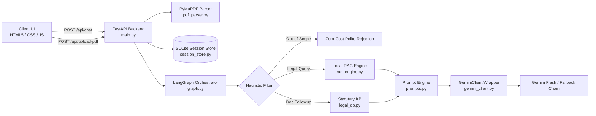

<div align="center">

# ⚖️ Jurista
### AI-Powered Indian Legal Assistant & Legal Document Explainer

[](https://www.python.org/)
[](https://fastapi.tiangolo.com/)
[](https://aistudio.google.com/)
[](https://pymupdf.readthedocs.io/)
[](LICENSE)

<p align="center">
  <b>Demystifying Indian law for citizens, consumers, and litigants.</b><br>
  Accessible statutory explanations, document intelligence, allegation distinction, and multilingual legal roadmaps.
</p>

[Key Features](#-key-features) •
[Architecture](#-system-architecture) •
[Quickstart](#-quickstart--installation) •
[API Reference](#-api-endpoints) •
[Verification](#-automated-testing) •
[Documentation](documentation.md)

</div>

---

## 📖 Overview

Navigating the Indian legal system is daunting for everyday citizens due to dense statutory language, complex procedural timelines, and intimidating legal notices. 

**Jurista** is an open-source, AI-powered legal assistant designed specifically for the **Indian legal framework**. It enables users to ask legal questions and upload legal documents (demand notices, agreements, court summons, police complaints) to receive **grounded, plain-language explanations**, actionable roadmaps, and statutory references.

> [!IMPORTANT]
> **Legal Ethics & Neutrality**: Jurista adheres strictly to legal-ethical guardrails. It never claims to be an attorney, clearly disclaims legal advice, and enforces an **Allegations Rule**—treating claims in opposing notices as *unilateral allegations* rather than proven facts.

---

## ✨ Key Features

- 📜 **Statutory Grounding in Indian Law**: Grounded in official Indian statutes from **India Code**, **eCourts**, and **NALSA**. Provides verifiable sections and procedural requirements without hallucinations.
- 📄 **Smart PDF Legal Explainer**: Powered by **PyMuPDF**. Ingests legal notices, petitions, and contracts, extracts text by page, identifies key parties, and summarizes claimed debts and obligations.
- 🔍 **Scanned PDF Detection**: Automatically detects image-only or scanned documents and provides practical guidance on obtaining OCR/text versions.
- ⚡ **Zero-Cost Heuristic Pre-Filter**: Instant regex pre-check rejects non-legal prompts (coding, cooking, math, entertainment) with zero latency and zero LLM cost.
- 🔄 **Resilient Multi-Model Failover**: Automatically recovers from model deprecations and high-demand spikes (HTTP 503) through a priority chain (`gemini-3.5-flash` ➔ `gemini-3.5-flash-lite` ➔ `gemini-3.6-flash` ➔ `gemma-4-31b-it`).
- 🌐 **Multilingual with Context Retention**: Seamlessly switch between **English**, **Hindi (हिंदी)**, and **Marathi (मराठी)** without resetting the chat history or losing the uploaded document context.
- 🔊 **Voice Accessibility (Text-to-Speech)**: Integrated browser Web Speech API enables audio playback of explanations for improved accessibility.
- 💾 **Isolated SQLite Sessions**: Complete thread-safe session isolation (`jurista_sessions.db`) keeping each user's document chunks and multi-turn context private.

---

## 🏛️ Supported Indian Statutory Domains

Jurista provides grounded citations and step-by-step procedures across key statutes:

| Statute | Sections Covered | Key Coverage |
| :--- | :--- | :--- |
| **Negotiable Instruments Act, 1881** | § 138, § 141, § 142 | Cheque dishonour, 30-day notice rule, 15-day cure period, corporate liability. |
| **Consumer Protection Act, 2019** | § 2(11), § 35 | Deficiency of service, defective goods, e-Daakhil filing, ₹50L District Commission limits. |
| **Bharatiya Nagarik Suraksha Sanhita, 2023** | BNSS § 173 (CrPC 154)<br>BNSS § 35 (CrPC 41A) | Zero FIR, procedure on refusal, Notice of Appearance protection against arrest. |
| **Bharatiya Nyaya Sanhita, 2023** | BNS § 303 (IPC 379)<br>BNS § 318 (IPC 420) | New criminal codification for theft, cheating, and dishonestly inducing property delivery. |
| **Real Estate (Regulation & Dev.) Act (RERA)** | § 18, § 31 | Delayed builder possession, interest refund claims, authority complaints. |
| **Right to Information Act, 2005** | § 6, § 7, § 19 | Public authority filing, ₹10 fee, 30-day / 48-hour life-or-liberty response mandates. |
| **Legal Services Authorities Act, 1987** | § 12 (NALSA) | Entitlement to free legal aid for eligible citizens (women, children, custody, low income). |

---

## 🏗️ System Architecture



---

## 🚀 Quickstart & Installation

### Prerequisites
- Python 3.10 or higher
- A Google Gemini API key from [Google AI Studio](https://aistudio.google.com/)

### 1. Clone the Repository
```bash
git clone https://github.com/your-username/jurista.git
cd jurista
```

### 2. Configure Environment Variables
Copy `.env.example` to create your local `.env`:
```bash
# On Windows
copy .env.example .env

# On Linux / macOS
cp .env.example .env
```

Open `.env` in a text editor and add your Gemini API key:
```env
GEMINI_API_KEY=AIzaSyYourActualKeyHere
GEMINI_MODEL=gemini-3.5-flash
PORT=8000
HOST=127.0.0.1
```

### 3. Install Dependencies
```bash
pip install -r requirements.txt
```

### 4. Run the Application

#### Option A: Windows One-Click Launcher
Simply double-click `run.bat` or run:
```cmd
run.bat
```
*(Automatically checks your Python environment, verifies `.env`, starts the server, and opens your browser.)*

#### Option B: Manual Terminal Execution
```bash
python main.py
```

The web application will be live at: **`http://127.0.0.1:8000/`**

---

## 🧪 Automated Testing

Jurista comes with a comprehensive end-to-end verification test suite:

```bash
python test_system.py
```

The automated suite tests **8 core workflows**:
1. Health check & Gemini API connectivity.
2. Zero-cost out-of-scope rejection filter.
3. Statutory retrieval with official India Code citations.
4. PyMuPDF in-memory PDF generation, multipart upload & chunking.
5. Context-retention follow-up on uploaded documents.
6. Dynamic session language switching (English $\rightarrow$ Hindi).
7. Multilingual Devanagari legal response generation.
8. Scanned / image-only PDF detection and guidance.

---

## 🔌 API Endpoints

| Method | Endpoint | Description |
| :--- | :--- | :--- |
| `GET` | `/api/health` | System status and Gemini model configuration. |
| `GET` | `/api/session/{session_id}` | Retrieve chat history and active document metadata. |
| `POST` | `/api/chat` | Main legal Q&A and document query endpoint. |
| `POST` | `/api/upload-pdf` | Ingest PDF, extract text with PyMuPDF, and generate summary. |
| `POST` | `/api/session/language` | Switch language (`English`, `Hindi`, `Marathi`) seamlessly. |
| `POST` | `/api/session/clear` | Reset conversation and clear document context. |

*Full request and response schemas are detailed in [documentation.md](documentation.md).*

---

## 🛡️ Ethics, Compliance & Disclaimers

1. **Bar Council of India Compliance**: Under the Advocates Act, 1961, automated legal services cannot solicit or provide formal representation. Jurista is an educational and informational tool, not a law firm.
2. **Consult a Professional**: Always verify legal documents with a practicing advocate or through the **National Legal Services Authority (NALSA Helpline: 15100)**.
3. **Data Privacy**: Uploaded PDFs and chat histories are processed locally on your server instance and stored in an isolated local SQLite database (`jurista_sessions.db`).

---

## 📄 License

This project is licensed under the [MIT License](LICENSE).
